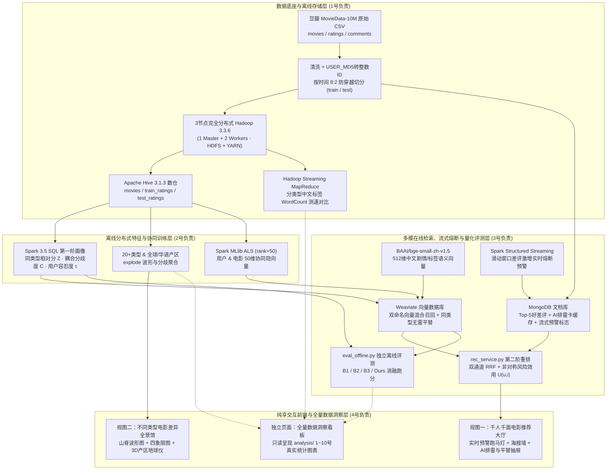

# 打破“均分迷信”与类型偏见：基于 Spark 与 Weaviate 的电影分歧感知与排雷推荐系统

> **《大数据架构与技术》课程设计 · 团队研发与协作主仓库**  
> **报告正式题目**：《基于 Spark 与多模数据库协同的电影评分分歧挖掘与个性化推荐系统设计与实现》  
> **答辩展示题目**：《打破“均分迷信”与类型偏见：基于 Spark 与 Weaviate 的电影分歧感知与排雷推荐系统》

-66CCFF?logo=apachehadoop&logoColor=black)


---

## 目录

- [一、项目破题定位与核心方案概览](#一项目破题定位与核心方案概览)
- [二、全栈大数据架构与组件职责矩阵](#二全栈大数据架构与组件职责矩阵)
- [三、核心两阶自研算法：TDC-Rec](#三核心两阶自研算法tdc-rec)
- [四、仓库目录结构与分支隔离规范](#四仓库目录结构与分支隔离规范)
- [五、四人分工、职责边界与里程碑推进](#五四人分工职责边界与里程碑推进)
- [六、全员锁死的数据契约与接口规范（严禁私改列名）](#六全员锁死的数据契约与接口规范严禁私改列名)
- [七、全量数据分析与可视化洞察规范（第七章契约）](#七全量数据分析与可视化洞察规范第七章契约)
- [八、分段环境启动、本地免重算同步与离线评测](#八分段环境启动本地免重算同步与离线评测)

---

## 一、项目破题定位与核心方案概览

传统电影推荐系统往往停留在“跑一遍协同过滤推出 10 部高分片”，忽视了题材天然均分偏差与两极争议踩雷风险。本项目基于豆瓣真实观影场景，从三大核心视角破题：

1. **打破“类型偏见”（体现不同类型电影的生态差异）**  
   动画片、纪录片在豆瓣天然均分高且打分集中（温和单峰型），而恐怖片、科幻片、先锋文艺片天然均分偏低且极易引发两极对立（双峰撕裂型）。系统利用 Spark 在所属电影类型内部计算每部影片的**同类型贝叶斯平滑相对分**，既避免小众类型佳作因绝对均分吃亏而被埋没，又全景刻画 20 余种电影类型与全球/华语产区的评分波形差异。
2. **打破“均分迷信”（千人千面防踩雷推荐）**  
   同样是高分电影，一部可能是全员打 4 星的“零差评稳妥佳作”，另一部可能是 5 星力荐与 1 星怒骂对半开的“两极争议大片”。系统结合用户历史常看题材比例与争议承受阈值，为**稳妥防雷派**观众精准剔除高争议雷片，为**猎奇探索派**影迷保留高分两极神作。
3. **打破“推荐黑盒”（Weaviate 双向量混合检索 + 轻量 RAG 点睛）**  
   以 Weaviate 双命名向量（512 维中文语义向量 + 50 维 ALS 协同隐向量）为核心实现**“一句话情境搜片”**与**“一键找 3 部同类型零差评平替片”**；点开争议电影详情时读取 MongoDB 真实五星好评与一星差评，用 15 行轻量大模型接口提炼正反方核心交锋点，生成直观的 **【AI 口碑排雷卡】**。

| 核心维度 | 定稿技术方案与关键参数说明 |
| :--- | :--- |
| **核心数据集** | 豆瓣影评数据集 **MovieData-10M**（14.05 万部电影、416.9 万条 1–5 星真实评分、442.8 万条中文短评，含海报、类型、产区、标签与剧情简介；前期切 2,000 部电影小样本 `data_small` 秒级联调） |
| **全满贯技术栈** | 3 节点完全分布式 Hadoop 3.3.6（HDFS + YARN）+ Spark 3.5 + Hive 3.1.3 数仓 + Weaviate 向量数据库（双命名向量）+ MongoDB 文档库 + Spark Structured Streaming 实时流计算 |
| **两阶自研算法** | **TDC-Rec**（*Type-Debiased & Divergence-Calibrated Recommendation*）：第一阶“类型自适应贝叶斯去偏 + 香农熵双峰耦合分歧建模”；第二阶“双通道倒数秩融合（RRF）+ 非对称风险效用重排” |
| **前端与评测解耦** | Web 端（Streamlit + Plotly/ECharts）提供纯享版暗黑双视图推荐产品 + 独立数据洞察看板；离线消融跑分由后台脚本 `eval_offline.py` 独立运行并导出高清评估图 |

---

## 二、全栈大数据架构与组件职责矩阵



| 平台组件 | 对应课程考核点 | 本项目真实业务职责 |
| :--- | :--- | :--- |
| **Hadoop 3.3.6 + Spark 3.5（3 节点完全分布）** | 必选底座 + 完全分布部署加分 | Docker Compose 虚拟局域网启动 `1 Master + 2 Workers` 三个独立容器节点，承载 HDFS 存储、YARN 调度、Spark SQL 特征聚合与 ALS 矩阵分解 |
| **Apache Hive 3.1.3** | Hive 数仓模块加分 | 规范管理清洗后的电影维表、时间切分 `train`/`test` 评分表及统计结果表；Spark 开启 `enableHiveSupport()` 直接 SQL 读写 |
| **Hadoop Streaming MapReduce** | 必选 MapReduce 算例 | 按“电影类型 + 中文标签”统计各类型高频标签词频（WordCount），并与同输入、同口径 Spark WordCount 进行公平测速对比 |
| **Weaviate 向量数据库** | 向量检索 + 应用可用性加分 | 单集合同时挂载 **512 维中文语义向量**与 **50 维 ALS 协同隐向量**，支撑双通道召回、自然语言情境搜片与毫秒级“同类型低分歧平替片”检索 |
| **MongoDB 文档数据库** | MongoDB 模块加分 | 存储变长嵌套 JSON 文档：每部电影精选 Top-5 五星好评与 Top-5 一星差评、AI 排雷总结缓存，以及流式实时口碑崩盘预警字段 |
| **Spark Structured Streaming** | 流计算框架加分 | 独立微批流处理监测模拟实时评分流，滑动窗口捕获近期 1 星差评激增（口碑崩盘）时自动写入 MongoDB 触发前端顶部跑马灯预警 |

---

## 三、核心两阶自研算法：TDC-Rec

**TDC-Rec**（*Type-Debiased & Divergence-Calibrated Recommendation*）采用轻量可解释的两阶架构，无需黑盒深度网络即可端到端解决**跨类型均分偏见**、**双峰争议识别**与**千人千面防踩雷重排**。

### 3.1 第一阶（离线并行画像层 — Spark SQL）：类型自适应贝叶斯去偏与耦合分歧建模

严格仅基于 **80% 历史训练集 `train`** 一次并行扫描计算三组核心特征：

#### （1）同类型贝叶斯平滑相对分 $Z(i \mid g)$
设电影 $i$ 所属主类型为 $g$（类型整体均分 $\mu_g$、标准差 $\sigma_g$），评分数为 $n_i$、原始均分为 $\bar{r}_i$，以先验权重 $m = 20$ 向所属类型均值做贝叶斯收缩后计算类型内标准分数：

$$R_{\text{Bayes}}(i) = \frac{n_i \cdot \bar{r}_i + 20 \cdot \mu_g}{n_i + 20}, \qquad Z(i \mid g) = \frac{R_{\text{Bayes}}(i) - \mu_g}{\sigma_g}$$

> **算例校验（供开发单元测试）**：设恐怖片 $\mu_g = 3.05, \sigma_g = 0.65$，动画片 $\mu_g = 4.05, \sigma_g = 0.45$。同为 $n_i = 80$ 人打分：原始均分 $3.80$ 的恐怖片得 $R_{\text{Bayes}} = 3.65, Z = +0.92$（同类型顶尖佳作）；原始均分 $3.85$ 的动画片得 $R_{\text{Bayes}} = 3.89, Z = -0.36$（同类型内偏平庸）。

#### （2）“香农熵—双峰”耦合分歧指数 $C_i \in [0, 1]$
融合归一化标准差 $\tilde{\sigma}_i = \sigma_i / 2.0$、好差评双峰极化度 $B_i = 4 \cdot P(r \ge 4) \cdot P(r \le 2)$ 以及五档归一化香农信息熵 $\tilde{H}_i = -\frac{1}{\ln 5}\sum_{b=1}^{5} p_{i,b}\ln p_{i,b}$，并乘以样本置信因子抑制极小样本噪声：

$$C_i = \frac{n_i}{n_i + 20} \times \left( 0.40 \cdot \tilde{\sigma}_i + 0.35 \cdot B_i + 0.25 \cdot \tilde{H}_i \right)$$

> **算例校验（$n_i = 100$）**：  
> - 温和共识好片 `[0, 5, 15, 65, 15]` $\rightarrow C_i \approx 0.293$  
> - 五档平庸均匀片 `[20, 20, 20, 20, 20]` $\rightarrow C_i \approx 0.631$  
> - 两极对骂争议片 `[40, 5, 0, 15, 40]` $\rightarrow C_i \approx 0.747$  
> 结合 $Z(i \mid g)$、$C_i$ 与 $n_i$，将全库影片划分为四大口碑象限：**大众稳妥神作**、**高分两极争议**、**小众冷门宝藏**、**低分避雷片**。

#### （3）用户类型偏好分布 $p_u(g)$ 与争议容忍度 $\tau_u \in [0, 1]$
统计用户 $u$ 在训练集中正评电影（$r \ge 4$）的各题材占比 $p_u(g)$，并综合其已看正评电影的平均分歧度与高争议片相对打分溢价归一化合成 $\tau_u$：
- $\tau_u < 0.28$：**稳妥防雷派**
- $0.28 \le \tau_u \le 0.50$：**均衡观影派**
- $\tau_u > 0.50$：**猎奇探索派**

### 3.2 第二阶（在线融合重排层 — Weaviate + Python）：双通道 RRF 与非对称风险重排

通过无参数倒数秩融合（RRF）消除 ALS 预测星级（1～5）与向量余弦相似度（0～1）之间的量纲失衡，再施加非对称超额风险惩罚与探索激励：

$$S_{\text{RRF}}(u, i) = 61 \times \left( \frac{0.5}{60 + \text{rank}_{\text{ALS}}} + \frac{0.5}{60 + \text{rank}_{\text{Vec}}} \right)$$

$$U(u, i) = S_{\text{RRF}}(u, i) + 0.20 \cdot \text{sigmoid}\big(Z(i \mid g)\big) + 0.15 \cdot p_u(g_i) - 1.2 \cdot \max(0, C_i - \tau_u)^{1.5} + 0.25 \cdot \mathbb{I}(\tau_u > 0.5) \cdot C_i$$

- 当电影分歧度 $C_i > \tau_u$ 时触发 $1.5$ 次幂超额风险扣分，保护稳妥观众不踩雷；
- 对 $\tau_u > 0.5$ 的猎奇影迷激活 $+0.25 \cdot C_i$ 风格探索加分；
- 截取 `Top-10` 时限制**单一主类型最多入选 4 部**，保障推荐单题材多样性。

---

## 四、仓库目录结构与分支隔离规范

遵循**“代码与轻量统计 CSV 走 GitHub，大于 50MB 的数据集与向量库走小组百度网盘”**以及**“物理目录硬隔离，零合并冲突”**原则：

```text
douban-rec-system/
├── 01_cluster_hive/          # [1号专属] 3节点集群编排、数据清洗防穿越切分、Hive/Mongo入库、MapReduce WordCount
├── 02_spark_als/             # [2号专属] Spark SQL 类型/产区统计、第一阶特征画像、Spark MLlib ALS 训练
├── 03_weaviate_stream_eval/  # [3号专属] Weaviate+MongoDB 编排、Spark Streaming 预警、rec_service.py、eval_offline.py
├── 04_web_app/               # [4号专属] mock_gen.py、Streamlit 暗黑双视图推荐大厅/全景馆、analysis_dashboard.py
├── analysis/                 # [固定契约] 全量数据分析 CSV 与高清 PNG 图表交接目录（严禁擅改字段名）
│   ├── 01_data/              #   ├─ 1号产出：全库评分分布、长尾分布、MapReduce vs Spark 耗时对比 + charts/
│   ├── 02_spark/             #   ├─ 2号产出：类型评分堆叠、分歧气泡图、类型×产区热力图、用户分布 + charts/
│   └── 03_eval/              #   └─ 3号产出：四模型消融指标对比、稳妥用户踩雷率对比、重排流向追踪 + charts/
├── data/                     # [本地数据] 原始 CSV、data_small、Parquet 宽表（已被 .gitignore 屏蔽，严禁 git add！）
├── screenshots/              # [考核存证] 3节点 jps、HDFS 存活节点、YARN WordCount、Spark DAG、数据库状态截图
├── .gitignore                # 屏蔽 >50MB 数据与持久化目录，放行 analysis/ 下固定契约轻量统计 CSV/PNG
└── README.md                 # 项目总览、契约字典、分段启动命令与协作规范
```

### Git 分支协作铁律
- **`main`**：稳定受保护主分支，仅通过验证无误的 Pull Request 合并。
- **`dev-1` / `dev-2` / `dev-3` / `dev-4`**：四位成员专属开发分支（已在远端初始化完毕）。
- **零冲突准则**：每人只修改自己专属编号目录（`0X_*/` 与 `analysis/0X_*/`）下的文件，**严禁跨目录直接修改上游队友脚本**。
- **大体量文件禁令**：切勿强行 `git add -f` 上传 `data/`、`*.parquet`、`weaviate_data/`、`mongo_data/`。

```bash
# 克隆仓库并切换到自己的开发分支（以 1号为例，2/3/4号替换为 dev-2 / dev-3 / dev-4）
git clone https://github.com/magicman667/douban-rec-system.git
cd douban-rec-system
git checkout dev-1
```

---

## 五、四人分工、职责边界与里程碑推进

### 5.1 成员认领与职责边界表

| 成员编号 | 认领人 | 开发分支 | 唯一维护目录与核心交付物 | 明确不负责事项（禁止越界） | 对口报告章节 |
| :--- | :--- | :--- | :--- | :--- | :--- |
| **1号（组长）**<br/>集群底座与多模入库 | [@magicman667](https://github.com/magicman667) | `dev-1` | `01_cluster_hive/`、`analysis/01_data/`<br/>• 3节点 Hadoop+Spark+Hive 集群<br/>• `data_small`、Hive `train`/`test`、Mongo 短评<br/>• MapReduce vs Spark WordCount 与图表 1～3 | 不计算 Spark 类型特征、不计算推荐模型指标、不开发前端页面 | 第 2 章：分布式平台与 MR 算例<br/>第 3 章：数据清洗与多模入库 |
| **2号成员**<br/>Spark 特征与 ALS 模型 | `【待填】` | `dev-2` | `02_spark_als/`、`analysis/02_spark/`<br/>• `movie_features.parquet`、`user_profiles.parquet`<br/>• `genre_stats.csv`、`region_stats.csv`、`als_factors.parquet`<br/>• 类型/产区/用户分布统计与图表 4～7 | 不负责原始数据清洗入库、不实现 Weaviate 检索、不跑最终消融评测 | 第 4 章：第一阶类型分歧挖掘与 ALS 并行化设计（含公式/DAG/调参） |
| **3号成员**<br/>Weaviate、流计算与评测 | `【待填】` | `dev-3` | `03_weaviate_stream_eval/`、`analysis/03_eval/`<br/>• Weaviate 双向量库 + Spark Streaming 差评预警<br/>• `rec_service.py` 在线重排与 AI 排雷平替接口<br/>• `eval_offline.py` 消融评估与图表 8～10 | 不重复计算 1、2 号基础统计、不开发 Streamlit 前端页面 | 第 5 章：双向量检索、第二阶重排、流式预警与量化实验分析 |
| **4号成员**<br/>暗黑双视图 Web 与统合 | `【待填】` | `dev-4` | `04_web_app/`<br/>• `mock_gen.py` 模拟生成器<br/>• Streamlit 推荐大厅 + 类型全景馆 + 数据洞察页<br/>• 90 秒高清录屏 MP4、报告排版与 5 分钟答辩 PPT | **严禁在前端重算评分分布、类型分歧、用户画像或评估指标**；不改 1～3 号代码 | 第 1 章：背景破题与团队分工<br/>第 6 章：可视化交互展示与总结；主导答辩 PPT |

### 5.2 四阶段里程碑闯关表

| 阶段 | 核心协同动作 | 准出验收标准 & 必存考核截图（归档至 `screenshots/`） |
| :--- | :--- | :--- |
| **M1：环境就绪与小样本解耦** | • 1号切出 2,000 部电影 `data_small` 发群，拉起 3 节点集群跑通标签 MapReduce WordCount<br/>• 3号用 Docker 启动 Weaviate + MongoDB 验证连通<br/>• 4号跑通 `mock_gen.py` 搭起暗黑双视图框架 | ✅ 3 节点 `jps` 进程截图、HDFS Web UI 存活节点截图、YARN WordCount `SUCCEEDED` 截图<br/>✅ 全组拿到 `data_small` 可在本地秒级运行 |
| **M2：小样本全链路本地串通** | • 1号将全量 416.9 万评分洗入 Hive、短评导入 MongoDB<br/>• 2号在 `data_small` 调通第一阶特征统计与 ALS 脚本<br/>• 3号在小样本建通 Weaviate、流式预警与第二阶重排接口<br/>• 4号完成视图二（不同类型电影差异全景馆）全部交互图 | ✅ 小样本跑通“选用户推荐 $\rightarrow$ 点争议片弹无雷平替与好差评”完整闭环<br/>✅ 山脊波形图、四象限发光散点图、3D 产区地球仪渲染正常 |
| **M3：全量数据顺承合体封板** | • 2号在 3 节点 Spark 集群跑出全量宽表与 50 维 ALS 向量<br/>• 3号提取全量 512 维语义向量灌入 Weaviate 并打包持久化目录<br/>• 4号无缝切换全量真数据，完成视图一推荐大厅与流式跑马灯 | ✅ Spark Web UI 并行 Stage/DAG 拓扑截图、Weaviate 与 MongoDB 状态截图<br/>✅ 全量真数据加载响应 `< 100ms`，豆瓣海报配置 `referrerpolicy="no-referrer"` 零裂图 |
| **M4：离线跑分出图与答辩归档** | • 3号运行 `eval_offline.py` 导出四模型消融结果与加速比曲线<br/>• 1、2、3号提交 `analysis/` 全部真实 CSV 与 PNG；4号接入“数据洞察”页<br/>• 4号录制 90 秒演示视频，全组统合报告、PPT 与百度网盘归档 | ✅ 离线评估证实 TDC-Rec 排序准确度提升且稳妥用户踩雷率大幅压降<br/>✅ 数据洞察页每张图均可追溯至真实 CSV，无任何手工伪造或预测冒充实测数据 |

---

## 六、全员锁死的数据契约与接口规范（严禁私改列名）

### 6.1 原始数据集（MovieData-10M）真实表头注意项（1号清洗必读）

原始 CSV 文件字段大小写存在差异，1 号清洗脚本需统一规范处理：
- **`movies.csv`**（21 列，大写）：`MOVIE_ID, NAME, ALIAS, ACTORS, COVER, DIRECTORS, DOUBAN_SCORE, DOUBAN_VOTES, GENRES, IMDB_ID, LANGUAGES, MINS, OFFICIAL_SITE, REGIONS, RELEASE_DATE, SLUG, STORYLINE, TAGS, YEAR, ACTOR_IDS, DIRECTOR_IDS`
- **`ratings.csv`**（5 列，大写）：`RATING_ID, USER_MD5, MOVIE_ID, RATING, RATING_TIME`（注：需将 32 位字符串 `USER_MD5` 确定性映射为 32 位正整数 `user_id`）
- **`comments.csv`**（14 列，小写）：`comment_time, content, created_at, douban_comment_id, douban_id, douban_user_avatar, douban_user_nickname, douban_user_url, id, rating, updated_at, votes, user_id, user_md5`（注：`douban_id` 对应 `movie_id`，需清除 `content` 内部换行符）

### 6.2 五大核心模块交接契约（锁死字段名与函数签名）

只要严格遵守以下 Schema，4 号基于 `mock_gen.py` 开发的页面与 3 号编写的检索服务在后期替换全量真表时**一行代码无需修改**：

```python
# ==============================================================================
# 契约 1：movie_features.parquet（2号产出 -> 3号、4号读取）
# ==============================================================================
# movie_id          : int        # 豆瓣电影整数 ID
# title             : str        # 电影名称
# cover_url         : str        # 豆瓣海报 URL（前端使用 referrerpolicy='no-referrer' 渲染）
# year              : int        # 上映年份
# genres            : list[str]  # 类型列表，如 ["剧情", "犯罪"]
# main_genre        : str        # 主类型，如 "剧情"
# regions           : list[str]  # 制片国家/地区列表，如 ["中国大陆", "中国香港"]
# tags              : str        # 原始中文标签串
# storyline         : str        # 清洗换行符后的剧情简介
# rating_count      : int        # 训练集评分人数 n_i
# bayesian_rating   : float      # 同类型贝叶斯平滑均分 R_Bayes(i)
# z_genre_score     : float      # 同类型内部相对标准分 Z(i|g)
# controversy_score : float      # 香农熵-双峰耦合分歧指数 C_i ∈ [0, 1]
# archetype_label   : str        # 四大口碑标签：大众稳妥神作 / 高分两极争议 / 小众冷门宝藏 / 低分避雷片
# hist_5bins        : list[int]  # 训练集 [1星人数, 2星人数, 3星人数, 4星人数, 5星人数]

# ==============================================================================
# 契约 2：user_profiles.parquet（2号产出 -> 3号、4号读取）
# ==============================================================================
# user_id           : int        # 映射后的纯整数用户 ID
# rating_count      : int        # 训练集历史打分总数
# tolerance_tau     : float      # 用户争议容忍度 τ_u ∈ [0, 1]
# user_type_label   : str        # 稳妥防雷派 (<0.28) / 均衡观影派 (0.28~0.50) / 猎奇探索派 (>0.50)
# genre_pref_json   : str        # JSON 字符串，记录用户对各类型的正评偏好占比 p_u(g)

# ==============================================================================
# 契约 3：genre_stats.csv & region_stats.csv（2号产出 -> 4号渲染视图二全景馆）
# ==============================================================================
# name, iso_code, movie_count, avg_bayesian_rating, avg_controversy,
# hist_ratio_5bins, top_consensus_movie, top_polarizing_movie

# ==============================================================================
# 契约 4：MongoDB 集合 douban_db.movie_reviews（1号导入短评 -> 3号写预警与RAG缓存 -> 4号读取）
# ==============================================================================
mongo_doc_example = {
    "movie_id": 1292052,
    "pos_comments": ["五星高赞短评1...", "五星高赞短评2..."],  # Top-5 五星好评
    "neg_comments": ["一星高赞短评1...", "一星高赞短评2..."],  # Top-5 一星差评
    "ai_summary": "正方盛赞叙事张力与视听语言；反方集中批评节奏拖沓与结局仓促。",
    "stream_alert": False,
    "recent_drop_msg": ""
}

# ==============================================================================
# 契约 5：03_weaviate_stream_eval/rec_service.py 三大在线接口（3号实现 -> 4号直接 import）
# ==============================================================================
def get_user_recommendations(user_id: int, genre_filter: str = None, top_k: int = 10) -> dict:
    """返回指定用户的 TDC-Rec Top-K 推荐结果、用户画像摘要及重排前后名次变动信息。"""
    ...

def search_by_scene(query_text: str, avoid_controversy: bool = True, top_k: int = 10) -> list[dict]:
    """基于 Weaviate 中文语义混合检索实现自然语言情境搜片，可选开启低分歧防踩雷过滤。"""
    ...

def get_controversy_detail_and_twins(movie_id: int) -> dict:
    """读取/生成 MongoDB AI 正反方口碑排雷总结，并通过 Weaviate 检索 3 部同类型零差评稳妥平替片。"""
    ...
```

---

## 七、全量数据分析与可视化洞察规范（第七章契约）

所有全量实测分析产物统一输出至根目录 `analysis/` 下，严格遵循**真实结果优先、严防数据穿越（特征取自 `train`，模型指标取自 `test`）、计算与展示分离、图表完全可复现**四大原则：

| 图表编号与名称 | 唯一负责人 | 交付目录 | CSV 文件名 | 锁死 CSV 字段名 | 对应静态图路径 |
| :--- | :---: | :--- | :--- | :--- | :--- |
| **1. 全库评分星级分布图** | 1号 | `analysis/01_data/` | `rating_distribution.csv` | `rating, count, ratio` | `charts/01_rating_distribution.png` |
| **2. 电影评分人数长尾图** | 1号 | `analysis/01_data/` | `movie_rating_count.csv` | `movie_id, title, rating_count` | `charts/02_movie_rating_longtail.png` |
| **3. MapReduce 与 Spark 耗时对比图** | 1号 | `analysis/01_data/` | `wordcount_runtime.csv` | `engine, run_id, input_records, runtime_sec` | `charts/03_wordcount_runtime.png` |
| **4. 不同类型评分结构堆叠图** | 2号 | `analysis/02_spark/` | `genre_rating_distribution.csv` | `genre, rating_1, rating_2, rating_3, rating_4, rating_5` | `charts/04_genre_rating_stacked.png` |
| **5. 类型口碑分歧气泡图** | 2号 | `analysis/02_spark/` | `genre_controversy.csv` | `genre, movie_count, avg_bayesian_rating, avg_controversy` | `charts/05_genre_controversy_bubble.png` |
| **6. 类型×产区分歧热力图** | 2号 | `analysis/02_spark/` | `genre_region_stats.csv` | `genre, region, movie_count, avg_controversy` | `charts/06_genre_region_heatmap.png` |
| **7. 用户类型分布图** | 2号 | `analysis/02_spark/` | `user_type_distribution.csv` | `user_type_label, user_count, ratio` | `charts/07_user_type_distribution.png` |
| **8. 四组推荐模型指标对比图** | 3号 | `analysis/03_eval/` | `model_metrics.csv` | `model, ndcg_10, recall_10, coverage_10` | `charts/08_model_metrics.png` |
| **9. 稳妥用户踩雷率对比图** | 3号 | `analysis/03_eval/` | `landmine_metrics.csv` | `model, landmine_10, conservative_user_count` | `charts/09_landmine_metrics.png` |
| **10. 推荐重排前后流向图（扩展）** | 3号 | `analysis/03_eval/` | `rerank_trace.csv` | `user_id, movie_id, rank_before, rank_after, controversy_score, tolerance_tau, user_type_label` | `charts/10_rerank_flow.png` |

> **交接异常处理规则**：4 号发现字段缺失或格式不一致时，通过 Issue / 接口问题清单反馈给对应唯一负责人修正并重新提交，**4 号不得在 `04_web_app/` 中自行复制计算逻辑作为临时补丁**。

---

## 八、分段环境启动、本地免重算同步与离线评测

### 8.1 基础运行环境要求
- **容器与集群环境**：Docker Desktop（建议分配 $\ge 8\text{GB}$ 内存）+ Docker Compose v2
- **Python 环境**：Python 3.10+（建议使用 `venv` 或 `conda` 独立虚拟环境）
- **核心 Python 依赖**：`pyspark==3.5.*`, `weaviate-client>=4.0`, `pymongo`, `sentence-transformers`, `pandas`, `pyarrow`, `streamlit`, `plotly`, `streamlit-echarts`, `matplotlib`, `seaborn`

### 8.2 四模块分段运行流程

```bash
# Step 1 [1号]：启动 3 节点 Hadoop+Spark+Hive 集群，执行清洗切分与 WordCount 基准对比
cd 01_cluster_hive
docker compose up -d
# 运行清洗切分脚本、Hive 建表入库、MongoDB 短评入库及 Hadoop Streaming / Spark WordCount

# Step 2 [2号]：基于 Hive train 表计算第一阶 TDC-Rec 特征、类型/产区统计与 ALS 50维隐向量
cd ../02_spark_als
# 提交 Spark 任务产出 movie_features.parquet, user_profiles.parquet, als_factors.parquet 及 analysis/02_spark/

# Step 3 [3号]：启动 Weaviate + MongoDB，灌入双向量，启动流式差评预警与离线消融评估
cd ../03_weaviate_stream_eval
docker compose up -d
# 运行向量灌库脚本、Spark Structured Streaming 微批监控脚本及 python eval_offline.py

# Step 4 [4号]：前期可先生成 Mock 数据独立开发，联调阶段直接启动 Streamlit 暗黑双页面系统
cd ../04_web_app
python mock_gen.py          # 仅前期无上游真表时运行
streamlit run app.py        # 启动主推荐系统与数据洞察看板
```

### 8.3 纯本地数据库“免重算”一键同步技巧（3号 $\rightarrow$ 4号答辩机）

为确保课堂离线/局域网投影答辩零故障、免去 4 号机器重复编码 14 万部电影向量：
1. 3 号在 `03_weaviate_stream_eval/docker-compose.yml` 中将容器数据卷挂载为当前目录下的 `./weaviate_data` 与 `./mongo_data`。
2. 全量灌库验证通过后，3 号将 `weaviate_data/`、`mongo_data/` 连同 2 号产出的 `*.parquet` 宽表压缩上传至小组百度网盘。
3. 4 号下载解压至本地对应路径，仅需执行 `docker compose up -d` 即可 10 秒原样复现完整向量库与文档库，离线稳妥答辩。

### 8.4 离线量化评估矩阵（`eval_offline.py`）

固定 `Top-10` 推荐列表，在时间切分测试集 `test` 上对比 **B1 热门高分基线**、**B2 标准 Spark ALS**、**B3 纯 Weaviate 向量检索** 与 **Ours（TDC-Rec 两阶完整算法）**：

| 评测维度 | 量化指标 | 指标物理含义 | 核心验证目标 |
| :--- | :--- | :--- | :--- |
| **排序准确性** | `NDCG@10` $\uparrow$ | 测试集用户真正喜爱电影排在推荐单前列的排序质量 | 验证 RRF 双通道协同+语义互补增益 |
| **命中召回率** | `Recall@10` $\uparrow$ | 推荐 Top-10 命中测试集用户真实正评电影的比例 | 验证剔除争议雷片后不损失有效召回 |
| **防踩雷安全度** | `Landmine@10` $\downarrow$ | 稳妥防雷派用户（$\tau_u < 0.28$）推荐单混入高争议雷片的比例 | **核心亮点**：验证非对称风险惩罚压降踩雷率 |
| **类型贴合度** | `GenreErr@10` $\downarrow$ | 推荐单题材分布与用户历史常看题材比例的平均偏差 | 验证类型亲和项与单题材上限约束 |
| **长尾挖掘力** | `Coverage@10` $\uparrow$ | 全体测试用户推荐单覆盖全库电影的去重比例 | 验证同类型去偏唤醒“小众冷门宝藏”能力 |

同时于报告第 2 章与第 5 章实测记录三项大数据系统性能指标：
1. **Hadoop MapReduce vs Spark 内存计算 WordCount 实测耗时与加速比**；
2. **3 节点完全分布式集群较单核并行训练加速比**；
3. **Spark Structured Streaming 微批预警延迟与 Weaviate + MongoDB 在线查询 P95 响应延迟**。

---

## 数据集致谢与合规声明

本项目使用公开学术数据集 **MovieData-10M**（豆瓣电影与影评数据集，采集自豆瓣电影，由中南大学刘帝伟等研究者整理发布），仅用于《大数据架构与技术》课程教学研究与实验验证，严格遵守数据集非商业使用与不公开二次转发要求。
